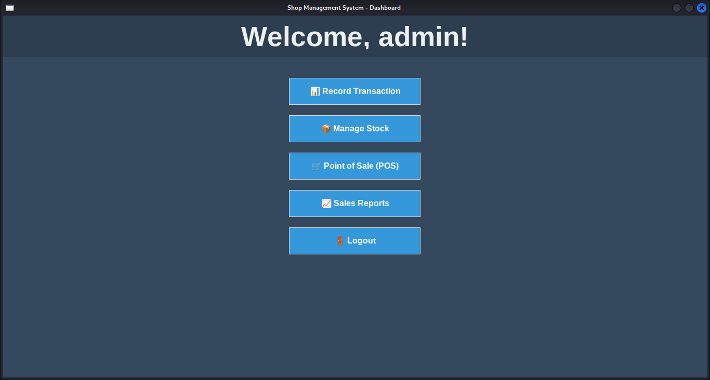
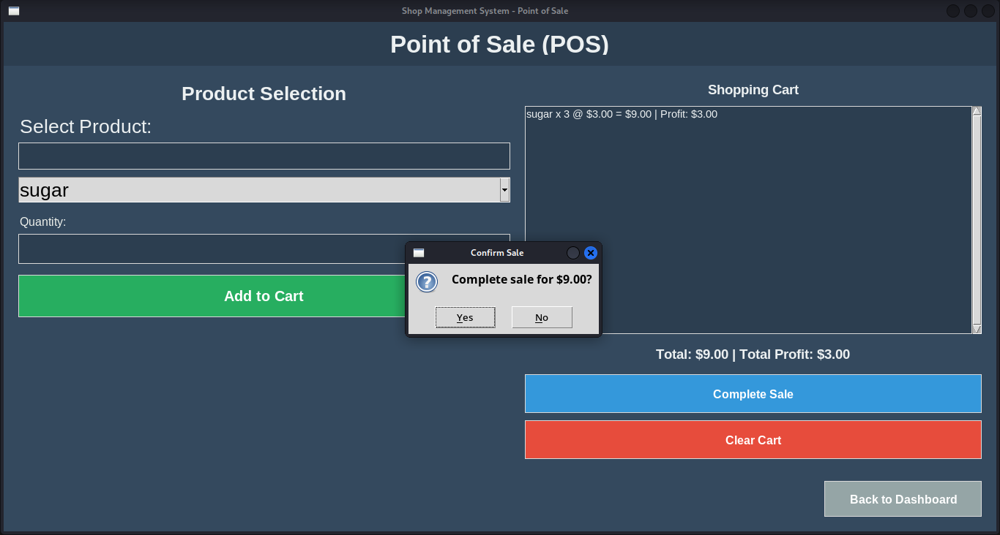
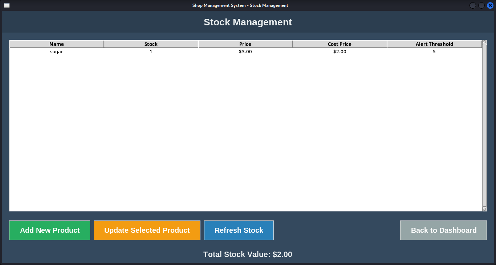
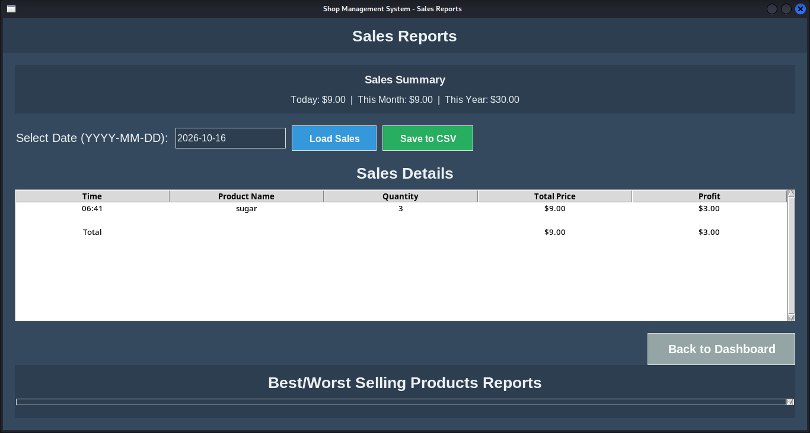

<div align="center">

# 🛒 Shop Management System

### Sales, stock and profit for your shop, on one desktop app that works fully offline.




</div>

---

## ✨ What is it?

A lightweight **point-of-sale and stock manager** for small retail shops. Ring up customers, keep an eye on what is running low, and see exactly how much **profit** you made, not just how much you sold. No internet, no subscriptions, no server: just Python and a single SQLite file.

| | Feature | What it does |
|---|---|---|
| 🛍️ | **Point of Sale** | Search a product, pick a quantity, build a cart and complete the sale in a few clicks. Every line shows its price **and profit** as you add it. |
| 📦 | **Stock Management** | Add and update products with selling price, cost price, description, stock level and an alert threshold. |
| 🔔 | **Low-stock alerts** | Get a warning when any product drops below its alert threshold. |
| 💰 | **Profit tracking** | Profit is calculated per sale from your cost price, so you always know your real margin. |
| 📈 | **Sales reports** | Instant **Today / This Month / This Year** totals, plus a day-by-day sales table with a total row. |
| 📄 | **CSV export** | Save any day's sales to a CSV file for Excel or Google Sheets. |
| 🧾 | **Record Transaction** | Log a sale manually by choosing a product and quantity. |
| 🏷️ | **Stock value** | See the total value of everything on your shelves (stock × cost price). |

---

## 📸 Screenshots

<table>
  <tr>
    <td align="center" width="50%">
      <br>
      <b>Point of Sale</b><br>
      <sub>Cart with per-line profit and a confirm-before-you-charge dialog</sub>
    </td>
    <td align="center" width="50%">
      <br>
      <b>Stock Management</b><br>
      <sub>Prices, cost prices, alert thresholds and total stock value</sub>
    </td>
  </tr>
  <tr>
    <td align="center" colspan="2">
      <br>
      <b>Sales Reports</b><br>
      <sub>Daily, monthly and yearly totals, sales by date, and one-click CSV export</sub>
    </td>
  </tr>
</table>

---

## 🚀 Quick start

**You need:** Python 3 with Tkinter.

```bash
# 1. Get the code
git clone https://github.com/YOUR-USERNAME/Shop-Management-System.git
cd Shop-Management-System

# 2. Install the dependency
pip install -r requirements.txt

# 3. Run it
python main.py
```

That's it. The database (`shop_management.db`) is **created automatically** the first time you run the app, in the folder you launch it from. Open **Manage Stock**, add your first product, and you're ready to sell.

> **Linux users:** Tkinter is a separate package on many distros.
> Install it with `sudo apt install python3-tk` (Debian/Ubuntu/Kali).
> On newer systems `pip` may ask you to use a virtual environment:
> `python3 -m venv venv && source venv/bin/activate && pip install -r requirements.txt`

---

## 🧮 How profit is calculated

```
Profit = (Selling price − Cost price) × Quantity
```

Example from the POS screen above: `sugar × 3 @ $3.00 = $9.00 | Profit: $3.00` (selling price $3.00, cost price $2.00).
Total stock value is stock × cost price, so it reflects what your inventory cost you.

---

## ⌨️ Handy shortcuts

| Shortcut | Where | Action |
|---|---|---|
| `Enter` | Record Transaction | Save the transaction |
| `Ctrl` + `Shift` + `S` | Sales Reports | Save the loaded day's sales to CSV |

Exported files are named `sales_YYYY-MM-DD.csv` and saved in the folder you launched the app from.

---

## 🗂️ Project structure

```
Shop-Management-System/
├── main.py          # The whole app: UI, POS, stock, reports
├── db.py            # SQLite connection + table creation
├── add_user.py      # Helper to add a user row (groundwork for login)
├── requirements.txt
├── docs/
│   └── screenshots/ # Images used in this README
├── LICENSE
└── README.md
```

**Database tables:** `products`, `transactions`, `cost_price_history`, `users`.

---

## 🛣️ Roadmap

Ideas on the list, roughly in order:

- [ ] **Best / worst selling products report** (the section is already on the Sales Reports screen but isn't populated yet)
- [ ] Sales graphs for the last 30 days
- [ ] Filter reports by date range, sort by quantity, revenue or profit
- [ ] Export reports to PDF as well as CSV
- [ ] Low-margin product alerts and cost-price change history (the table already exists)
- [ ] Search improvements: auto-complete, recent products, favourites
- [ ] Tooltips for keyboard shortcuts, and confirmation dialogs for destructive actions
- [ ] Login screen and multiple users (`add_user.py` and the `users` table are the starting point)

---

## 📝 Good to know

- **No login screen yet.** The app opens straight to the dashboard, so it is meant for a single, trusted computer. Anyone who can open the app can see and change your data.
- **Your data lives in one file.** `shop_management.db` holds everything. Copy it somewhere safe regularly to back up your shop. It is listed in `.gitignore` so it never gets pushed to GitHub by accident.
- Currency is shown with a `$` symbol.

---

## 📄 License

Released under the [MIT License](LICENSE). Free to use, change and share.

<div align="center">

**Built by Brandon** · If this helped you, give it a ⭐

</div>
